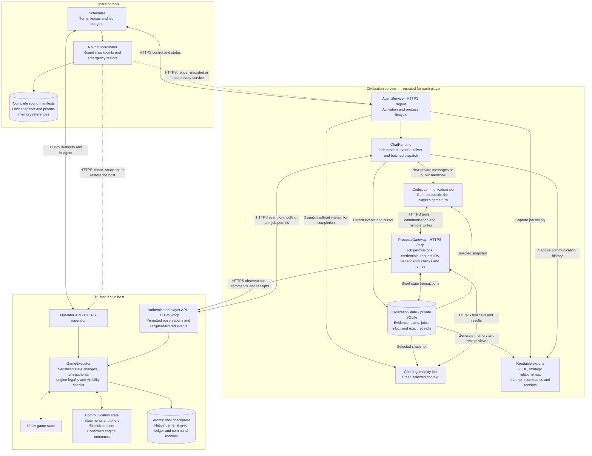

# Gameplay, asynchronous chat and recovery

The civilization-service block is repeated for Rome, Greece and each additional
player. Every service has its own jobs, credentials and private memory. Host and
service network endpoints use HTTPS; local Codex process control uses a Unix
WebSocket.

Only application code waits for events. Gameplay and communication computations
can overlap while memory transactions and action approval remain serialized.
Communication jobs can inspect permitted game information, but cannot issue
gameplay commands. Models select actions and entity IDs; the gateway supplies
transport credentials, request identities and observed versions.

Normal interruption preserves confirmed work. The dashed recovery paths represent
coordinated checkpointing and explicit whole-match restoration; restore creates a
new epoch, rotates credentials, restores all private memory views and retains usage
accounting. The manifest is published only after every component is durable.

See the [implementation guide](Chat-memory-and-recovery.md) for launch commands,
memory layout, verification and remaining coverage/isolation limits.
