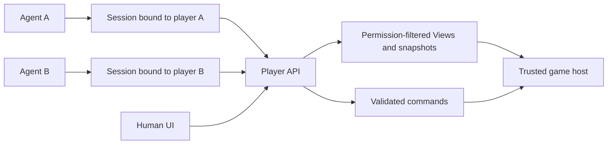

**Player agent API review**

Reviewed 2026-09-06 against `d77a312ed6ba0d127fe4efdfbcdc9f4918c0b5fa`. Scope: connecting multiple external agents to an existing game, with ordinary human player capabilities and information permissions. Covers the bundled Vanilla and Gods & Kings rulesets; custom mods and generic mod extension APIs are excluded. This is a source review and proposed design, not an implemented or runtime-verified security boundary.

The [implementation plan](Player-agent-implementation-plan.md) turns this review into proposed atomic PRs, with hard dependencies, linked work, acceptance criteria and staged integration gates.

The View refactor is the right foundation, but it currently provides wrappers and partial consumer migration rather than enforceable player isolation. The missing work has three parts: complete player commands, complete player observations, and enforce permissions throughout both. A transport adapter alone cannot make the existing Views safe.

**Recommended architecture**



Run one authoritative game host. Each connection has a server-assigned identity bound to a game and civilization. The host resolves that identity to a View and executes commands; requests never choose the acting civilization, spectator mode, or viewing perspective. Multiple agents may remain connected and reason concurrently, while the existing sequential turn model determines who may act.

Use a transport-neutral Kotlin player API with explicit serializable request/result types. JSON over a local socket or HTTP is sufficient; an MCP adapter can expose the same contract later. Do not serialize existing View instances reflectively. They currently contain live engine references and public escape methods. The external response should be an explicitly constructed, detached data transfer object (DTO).

This also requires process isolation: agents must not be able to read full saves, host credentials, other players' transcripts, debug endpoints, or the host's memory, or modify the running engine. Views cannot guarantee secrecy if an agent also has unrestricted filesystem or code execution access to the authoritative game. Public source code and static ruleset definitions are fine.

The existing multiplayer service is not this boundary: [MultiplayerServer](../vendor/Unciv/core/src/com/unciv/logic/multiplayer/storage/MultiplayerServer.kt) uploads and downloads serialized `GameInfo`. Keep those credentials and saves on the trusted host. Do not give each agent an ordinary full-save multiplayer client and expect the View layer to hide the rest.

**1. APIs for controlling a player**

The following are semantic operations, not a requirement for a separate network route per operation. A typed `submitCommand` endpoint can dispatch them. Names below are proposed, not existing APIs. Return available choices and costs separately so an agent does not have to guess arguments or parse button labels.

| Command family | Required operations for built-in gameplay | Existing implementation to extract or reuse |
| --- | --- | --- |
| Turn and attention | End turn; execute queued/automated unit orders; skip a unit; defer optional policy/spy reminders; resolve mandatory decisions before proceeding. Distinguish actual blockers from configurable idle-unit reminders. | [NextTurnAction](../vendor/Unciv/core/src/com/unciv/ui/screens/worldscreen/status/NextTurnAction.kt), [WorldScreen.nextTurn](../vendor/Unciv/core/src/com/unciv/ui/screens/worldscreen/WorldScreen.kt#L594), [GameInfo.nextTurn](../vendor/Unciv/core/src/com/unciv/logic/GameInfo.kt#L382) |
| Movement | Move toward a coordinate; set/cancel a multi-turn destination; swap units; start/stop escort formation; air rebase to cities/carriers; paradrop, including the Great Admiral's change-port ability. Embark/disembark follow ordinary movement rules. | [MapUnitView](../vendor/Unciv/core/src/com/unciv/view/MapUnitView.kt), [UnitMovement](../vendor/Unciv/core/src/com/unciv/logic/map/mapunit/movement/UnitMovement.kt), [WorldMapHolder](../vendor/Unciv/core/src/com/unciv/ui/screens/worldscreen/worldmap/WorldMapHolder.kt) |
| Unit orders | Sleep, sleep until healed, fortify, fortify until healed, guard, wake/cancel orders, explore, automate workers, connect road to a destination, stop automation. | [UnitActions](../vendor/Unciv/core/src/com/unciv/ui/screens/worldscreen/unit/actions/UnitActions.kt), [UnitActionsFromUniques](../vendor/Unciv/core/src/com/unciv/ui/screens/worldscreen/unit/actions/UnitActionsFromUniques.kt) |
| Combat | Melee/ranged attack, move-and-attack, city bombardment, siege setup, air strike, air sweep, nuclear strike. Represent war-declaration confirmations explicitly. Passive interception remains an engine effect. | [BattleTable](../vendor/Unciv/core/src/com/unciv/ui/screens/worldscreen/bottombar/BattleTable.kt), [Battle](../vendor/Unciv/core/src/com/unciv/logic/battle/Battle.kt), [Nuke](../vendor/Unciv/core/src/com/unciv/logic/battle/Nuke.kt), [TargetHelper](../vendor/Unciv/core/src/com/unciv/logic/battle/TargetHelper.kt) |
| Unit development and disposition | Choose promotions, save/apply the promotion preferences offered by the UI, upgrade, rename, disband, gift a unit, keep/return a recaptured civilian. | [PromotionPickerScreen](../vendor/Unciv/core/src/com/unciv/ui/screens/pickerscreens/PromotionPickerScreen.kt), [UnitActionsUpgrade](../vendor/Unciv/core/src/com/unciv/ui/screens/worldscreen/unit/actions/UnitActionsUpgrade.kt), [UnitActions](../vendor/Unciv/core/src/com/unciv/ui/screens/worldscreen/unit/actions/UnitActions.kt), [AlertPopup](../vendor/Unciv/core/src/com/unciv/ui/screens/worldscreen/AlertPopup.kt) |
| Settlement and improvements | Found city; start/cancel improvement work, including feature/road removal and repair; perform the UI's compound improvement order; create work-boat and great-person improvements; pillage. | [ImprovementPickerScreen](../vendor/Unciv/core/src/com/unciv/ui/screens/pickerscreens/ImprovementPickerScreen.kt), [UnitActionsFromUniques](../vendor/Unciv/core/src/com/unciv/ui/screens/worldscreen/unit/actions/UnitActionsFromUniques.kt), [UnitActionsPillage](../vendor/Unciv/core/src/com/unciv/ui/screens/worldscreen/unit/actions/UnitActionsPillage.kt) |
| Great people and spaceship | Start Golden Age, hurry research or construction, conduct trade mission, create special improvement, choose a free great person including Maya choices, add spaceship part in capital. Expose only abilities supported by the selected bundled ruleset and unit. | [UnitActionsGreatPerson](../vendor/Unciv/core/src/com/unciv/ui/screens/worldscreen/unit/actions/UnitActionsGreatPerson.kt), [UnitActionsFromUniques](../vendor/Unciv/core/src/com/unciv/ui/screens/worldscreen/unit/actions/UnitActionsFromUniques.kt), [GreatPersonPickerScreen](../vendor/Unciv/core/src/com/unciv/ui/screens/pickerscreens/GreatPersonPickerScreen.kt) |
| City production | Set/add/remove/reorder production queue; choose perpetual production; purchase with allowed currency; sell building; enable/disable construction preferences locally or empire-wide; configure saved promotions for new units. Include target-tile selection where the standard construction requires it. | [CityView](../vendor/Unciv/core/src/com/unciv/view/CityView.kt), [CityConstructionsView](../vendor/Unciv/core/src/com/unciv/view/CityConstructionsView.kt), [CityConstructionsTable](../vendor/Unciv/core/src/com/unciv/ui/screens/cityscreen/CityConstructionsTable.kt) |
| City population and territory | Work/unwork/lock/unlock tiles; assign/unassign specialists; automatic/manual specialists; city focus; avoid growth; reassign population; buy tile; rename city. | [CityView](../vendor/Unciv/core/src/com/unciv/view/CityView.kt), [CityScreen](../vendor/Unciv/core/src/com/unciv/ui/screens/cityscreen/CityScreen.kt) |
| City ownership decisions | Annex/puppet/raze/liberate/keep/destroy when offered by conquest, trade, or diplomatic marriage; stop razing; annex an existing puppet. These options are context-dependent, not arbitrary ownership setters. | [AlertPopup](../vendor/Unciv/core/src/com/unciv/ui/screens/worldscreen/AlertPopup.kt), [CityScreen](../vendor/Unciv/core/src/com/unciv/ui/screens/cityscreen/CityScreen.kt) |
| Research and policies | Set/reorder research plan, choose free technology, adopt policy/open branch, defer policy choice where allowed, set gold-to-science conversion when enabled. | [TechPickerScreen](../vendor/Unciv/core/src/com/unciv/ui/screens/pickerscreens/TechPickerScreen.kt), [PolicyPickerScreen](../vendor/Unciv/core/src/com/unciv/ui/screens/pickerscreens/PolicyPickerScreen.kt), [CivView](../vendor/Unciv/core/src/com/unciv/view/CivView.kt) |
| Religion | Found/expand pantheon; initiate founding/enhancement through the eligible unit; choose religion name/icon and beliefs; resolve free-belief choices; spread religion; remove heresy; purchase religious units through city purchase. | [PantheonPickerScreen](../vendor/Unciv/core/src/com/unciv/ui/screens/pickerscreens/PantheonPickerScreen.kt), [ReligiousBeliefsPickerScreen](../vendor/Unciv/core/src/com/unciv/ui/screens/pickerscreens/ReligiousBeliefsPickerScreen.kt), [UnitActionsReligion](../vendor/Unciv/core/src/com/unciv/ui/screens/worldscreen/unit/actions/UnitActionsReligion.kt) |
| Major-civ diplomacy | Declare war, negotiate peace, denounce, propose/respond to friendship, make/respond to demands and promises, respond to protected-city-state incidents. | [MajorCivDiplomacyTable](../vendor/Unciv/core/src/com/unciv/ui/screens/diplomacyscreen/MajorCivDiplomacyTable.kt), [AlertPopup](../vendor/Unciv/core/src/com/unciv/ui/screens/worldscreen/AlertPopup.kt) |
| Trades | Inspect available offers, propose/retract, accept/decline/counter. Support gold, gold per turn, resources, cities, embassies, open borders, research agreements, defensive pacts, peace treaties, introductions and third-party war/peace offers when available in the normal trade menu. Validate both sides again on acceptance. | [TradeView](../vendor/Unciv/core/src/com/unciv/view/TradeView.kt), [TradeLogic](../vendor/Unciv/core/src/com/unciv/logic/trade/TradeLogic.kt), [TradePopup](../vendor/Unciv/core/src/com/unciv/ui/screens/worldscreen/TradePopup.kt) |
| City states | Gift gold/unit/improvement, demand gold/worker tribute, pledge/revoke protection, declare war/make peace, diplomatic marriage for the eligible nation. Quests generally progress through other gameplay actions. | [CityStateDiplomacyTable](../vendor/Unciv/core/src/com/unciv/ui/screens/diplomacyscreen/CityStateDiplomacyTable.kt), [CityStateFunctions](../vendor/Unciv/core/src/com/unciv/logic/civilization/diplomacy/CityStateFunctions.kt) |
| Espionage | Move/recall spy, inspect eligible city, schedule/cancel coup. Stealing technology, election rigging and counterintelligence follow the existing spy state machine; do not expose arbitrary spy-state assignment. | [EspionageOverviewScreen](../vendor/Unciv/core/src/com/unciv/ui/screens/overviewscreen/EspionageOverviewScreen.kt), [Spy](../vendor/Unciv/core/src/com/unciv/models/Spy.kt) |
| Votes and messages | Vote/abstain in diplomatic victory election; resolve pending diplomatic responses; acknowledge notifications/alerts. If game chat is part of the host, expose only channels the player may read/send to. | [DiplomaticVotePickerScreen](../vendor/Unciv/core/src/com/unciv/ui/screens/pickerscreens/DiplomaticVotePickerScreen.kt), [AlertPopup](../vendor/Unciv/core/src/com/unciv/ui/screens/worldscreen/AlertPopup.kt), [ChatPopup](../vendor/Unciv/core/src/com/unciv/ui/screens/worldscreen/chat/ChatPopup.kt) |

For this scope, use a finite command set with validated built-in technology, policy, belief, improvement and unit identifiers. Still provide `getAvailableActions(entity)` and option queries: eligibility varies with research, nation, religion, location and resources even without mods. An action descriptor contains a stable kind, allowed parameter choices or query links, known costs, public disabled reasons and confirmation requirements. It does not contain a callable closure or accept arbitrary unique text.

Create a shared `DecisionView` for pending choices: stable decision ID, kind, permitted subject information, options, known consequences, whether deferrable, and whether it blocks turn completion. Submit `resolveDecision(id, option, parameters)` and revalidate the live decision. This covers conquest, civilian return, free technology/great-person/belief choices and diplomatic responses without having to open a popup. Bundled Gods & Kings `Events.json` currently contains tutorial tasks; a generic mod-event execution API is unnecessary here.

Pure presentation interactions such as selecting units, camera movement, screen tabs and tooltip expansion need no game command. Expose the information they reveal through queries. Cosmetic settings can remain client-local. Resign, undo, postgame continuation and save/load need an explicit host policy: expose ordinary player operations only where that game permits them; save export, reload and spectator/debug controls are host administration. If ordinary undo is enabled, provide equivalent bounded undo for both human and agent players and keep already-observed knowledge; otherwise disable it for both. Neither side can forget information revealed before an undo.

**2. APIs for obtaining human-visible information**

Provide one coherent `observe()` snapshot for routine play, plus focused detail queries and incremental updates for larger maps. Include structured values and optional human-readable explanations. Tooltips, overviews and previews are part of information parity, not just the map and top bar.

| Query surface | Required contents | Permission considerations |
| --- | --- | --- |
| Session and turn | Bound player, game/ruleset identity, public settings, turn/year, phase, whether the player may act, blockers, pending decisions, ended/defeated state. | Do not dump `GameParameters`, map seed, player credentials, or an undiscovered roster. Mask current-player identity where the chosen information policy requires it. |
| Rules reference | Bundled ruleset definitions, Civilopedia descriptions, technology/policy trees, unit/promotion/building/improvement/belief costs and effects, enabled victory rules. | Static definitions are public; active entity instances and hidden map generation data are not. Resolve context-dependent costs/effects on the server. |
| Empire | Treasury and income, science/culture/faith, happiness, Golden Age progress, resource supply/use/trades, upkeep, unit supply, great-person progress, detailed stat breakdowns. | Own empire. Foreign values only through the particular diplomatic/statistical disclosure that permits them. |
| Map | Coordinate-based map observations, explored/visible states, terrain/features/rivers, borders, known resources and quantities, shown improvements/roads/pillage, permitted tile yields and breakdowns, visible cities and units. | Unknown is different from empty. Model resource reveal requirements, invisible-unit detection and remembered versus current fields. |
| Units | Own unit list and detail: identity/type/location, HP, movement, attacks remaining, XP/promotions, statuses, religion/charges, orders/destination, escort/cargo, upgrade and promotion choices. Visible foreign units get only inspection information offered to a human. | Do not disclose enemy orders, full promotion-manager internals, remaining movement or other private fields merely because a unit is visible. Audit each field against the actual inspection UI. |
| Cities | Own city list/detail: population/food/growth, worked and locked tiles, specialists, buildings, production queue/progress/overflow, purchases, yields and modifier trees, happiness, expansion, religion/pressure, great-person generation, resistance/puppet/raze state and resources. | Foreign city banners, spy inspection and own management are different grants. A trade mentioning a city does not authorize its full CityView. |
| Planning and combat | Possible moves/targets, route and movement-cost estimates, swap/rebase/paradrop destinations, improvement options/turns/yield changes, construction/promotion choices, battle strengths/modifiers/damage ranges, nuclear/air-sweep previews matching the UI. | These are filtered observations too. No all-knowing pathfinding, invisible target enumeration, exact future RNG outcome, or hidden-unit-specific rejection reason. |
| Research, policies and religion | Researched technologies and plan/progress, available research and free picks, adopted policies/branches and next costs, faith/pantheon/religion state, available beliefs, religion overview and permitted followers/pressure. | Other religions can be public while founder or holy-city location is unknown. Expose only the specific foreign facts available through the corresponding UI. |
| Diplomacy and trade | Contacts, relationship/opinion modifiers, wars/treaties/promises and remaining durations, available offers, incoming/outgoing requests, active deals and resource commitments. | Negotiation may legitimately reveal gold, resources and tradable city names. It does not grant raw inventories, other negotiations or AI trade valuations/plans. |
| City states and quests | Known city states, type/personality, influence/decay/thresholds, ally/protection, benefits, gifts and tribute previews, assigned quest objectives/progress/deadlines/rewards. | Include only the player's assigned quests and permitted public contest standings. Scope third-party identities and locations separately. |
| Espionage | Own spies, rank/location/action/progress, eligible destinations, available city inspections, coup estimate and known reports. | A spy inspection grants particular city data; it never grants control of that city or its owner's other cities/units. |
| Notifications and history | Player notification log, permitted links/icons, observed movement and attacks, diplomatic and spy reports, pending alerts. | Preserve what was observed at event time. Losing sight is not evidence of destruction; unseen origin or identity can remain unknown even when damage is known. |
| Overviews and victory | Unit/city/resource/trade/religion summaries, wonders, global politics, demographics, rankings/charts, own/global victory milestones and election results as permitted. | Respect `hideOtherCivilizationStats`, hidden civilization counts, unmet identities, wonder-location masking and postgame disclosure rules. Aggregates can be public without revealing all contributing entities. |

Concrete migration references include [TileDescription](../vendor/Unciv/core/src/com/unciv/ui/objectdescriptions/TileDescription.kt), [BattleTable](../vendor/Unciv/core/src/com/unciv/ui/screens/worldscreen/bottombar/BattleTable.kt), [EmpireOverviewScreen](../vendor/Unciv/core/src/com/unciv/ui/screens/overviewscreen/EmpireOverviewScreen.kt), [WonderOverviewTab](../vendor/Unciv/core/src/com/unciv/ui/screens/overviewscreen/WonderOverviewTab.kt), [ReligionOverviewTab](../vendor/Unciv/core/src/com/unciv/ui/screens/overviewscreen/ReligionOverviewTab.kt) and [VictoryScreen](../vendor/Unciv/core/src/com/unciv/ui/screens/victoryscreen/VictoryScreen.kt).

The current UI already contains disclosures that are more permissive than simple fog-of-war rules. For example, trade lists expose gold/GPT and tradable cities; the city-state improvement gift menu uses that city state's resource visibility; demographics expose aggregates. Define which disclosures are intended and move those policies into shared Views. If a UI disclosure is judged a bug, fix both consumers. Otherwise silently removing it from the agent gives the human an advantage.

**3. Views needed to enforce the boundary**

These are logical interfaces/result types. They need not become a wrapper class per implementation manager.

| View or result | Work required |
| --- | --- |
| `GameView` / player session | Add safe root queries and resolution by scoped identifiers. Bind viewer, game epoch and permissions internally. Separate the actor's write authority from read-only inspection. Never derive API identity from the UI's selected civilization. |
| `CivView` and `ForeignCivView` | Make full CivView self-only; foreign view contains separately authorized contact/diplomatic/public information. Add empire/research/policy/resource/great-person observations and commands without returning managers. |
| `TileMapView` and `TileView` | Replace unsafe raw-tile navigation with coordinate observations. Represent unknown, explored/remembered, and currently visible fields. Resource queries always use the bound viewer. Keep public geometry separate from terrain, units and mutable map state. |
| `CityView`, `ForeignCityView`, city inspection | Preserve foreign-to-inspection navigation, but enforce own/spy/spectator grants at every entry point. An inspected foreign city exposes allowed city-screen reads and zero management authority. Ordinary foreign data must not navigate to a full owner CivView. |
| `CityConstructionsView` | Detached production options, queue/progress, costs, known rejection reasons and validated production/purchase operations under the city's ownership policy. |
| `MapUnitView` and `ForeignMapUnitView` | Full unit state/actions for owned units; bounded observed foreign unit snapshots; safe current visibility and history. Add missing own-unit detail and commands. Separate historical sightings from a live unit handle. |
| Movement and `CombatPreviewView` | Player-knowledge path/target estimates and UI-equivalent battle previews. The engine can use full state when executing, but preview output must obey the player's information policy. |
| Research, policy and promotion results | Choices, prerequisites, progress/costs, effects and command eligibility. No TechManager, PolicyManager or UnitPromotions escape. |
| Religion results | Own religious state/choices and public religion information; city religious data according to inspection permissions. No raw Religion with `gameInfo`/`foundingCiv` backreferences. |
| `DiplomacyView`, `TradeView`, `CityStateView`, quest results | Explicit bilateral/public data, detached offers, participant-bound requests, legal diplomatic actions and relevant quests. No raw DiplomacyManager or private AI evaluations. |
| `EspionageView` / spy results | Own spies and inspection grants, allowed destinations/actions and reports. Revoke live inspection on spy movement/death while preserving previously learned information. |
| `DecisionView`, notification and observed-event results | Durable IDs, permitted choices, safe text/links and event-time facts. Both UI and external players consume the same decision lifecycle. |
| Victory/statistics/history results | Extract screen-specific disclosure rules and frozen ranking snapshots; expose permitted aggregates and timelines. Keep unrestricted replay/spectator information behind a separate role. |
| `RulesetReference` | Read-only public definitions without mutable engine aliases or runtime game references. Built-in identifiers suffice; no generic mod command mechanism. |

**Concrete blockers in the current implementation**

The following are source-level findings. Missing checks in a wrapper do not imply every downstream engine operation lacks its own checks, but the API boundary itself cannot currently establish the required guarantees.

1. **Foreign data can escalate to full civilization access.** [ForeignCityView.owningCivView](../vendor/Unciv/core/src/com/unciv/view/ForeignCityView.kt#L23) calls the unrestricted [GameView.getCivView](../vendor/Unciv/core/src/com/unciv/view/GameView.kt#L20). From an ordinary foreign city, a consumer can reach `owningCivView.cities()` and `getUnits()`, exposing its owner's full city/unit collection. The guarded `tryGetCityView()` path is bypassable through public factories. Make full-view creation enforce permissions, and return ForeignCivView for a foreign owner.

2. **Raw object and manager escapes defeat filtering.** `getCiv()`, `getCity()`, `getUnit()`, `getTile()`, `getCombatant()`, `getCityConstructions()`, public `viewer` properties, `CityView.getState()`, raw Religion and promotion/diplomacy managers reopen the unrestricted object graph. Remove them from the player contract. Trusted bootstrap adapters may still accept raw engine objects, but must not be exposed as player operations.

3. **Tile fields are not uniformly filtered.** [TileView](../vendor/Unciv/core/src/com/unciv/view/TileView.kt#L116) has a filtered resource helper, but also unconditionally exposes `resource`, `resourceAmount`, `improvement`, improvement work and other live fields. `getViewableResource(null)` returns the resource without a reveal-tech check. [TileMapView](../vendor/Unciv/core/src/com/unciv/view/TileMapView.kt#L18) expressly allows unexplored raw-tile wrapping. Safety currently depends on callers selecting the right getters and hiding results. Filtering must happen in the contract, including nested fields and yields.

4. **Write authority is incomplete.** [MapUnitView actions](../vendor/Unciv/core/src/com/unciv/view/MapUnitView.kt#L68) and [CivView actions](../vendor/Unciv/core/src/com/unciv/view/CivView.kt#L108) lack a common actor/turn/spectator check. [CityView.canChangeState](../vendor/Unciv/core/src/com/unciv/view/CityView.kt#L150) checks ownership and current player but omits `spectatorMode`; several actions depend on validation performed by the UI, and specialist allocation directly adjusts counters. [CityConstructionsView.purchaseConstruction](../vendor/Unciv/core/src/com/unciv/view/CityConstructionsView.kt#L49) has no view-level authorization guard. Every command needs authority and domain validation independent of its caller.

5. **Trade does not preserve a reliable session boundary.** [TradeView](../vendor/Unciv/core/src/com/unciv/view/TradeView.kt) constructs its own viewer context, does not propagate spectator mode, returns live mutable offer lists, and proposes a staged trade after only checking that it is nonempty. Require the bound actor, permitted counterparty, valid offers/amounts/treaties and live acceptance checks. A request to another player is a proposal; it cannot execute that player's consent.

6. **Read-only annotations and collection interfaces are insufficient.** A Kotlin `List` can still alias mutable game state, and elements such as Stats, Counter and promotion/status objects can be mutable. Current views return several such aliases. Return detached immutable nested values. Keep purity checks, but do not treat them as permission checks or deep immutability enforcement.

7. **Planning can become a hidden-state oracle.** [MapUnitView](../vendor/Unciv/core/src/com/unciv/view/MapUnitView.kt#L33) forwards movement queries and wraps returned tiles. Attack-range enumeration can produce unexplored TileViews, and `getValidRoadConnectionTiles()` scans the map. [UnitMovement](../vendor/Unciv/core/src/com/unciv/logic/map/mapunit/movement/UnitMovement.kt#L707) uses actual occupancy and terrain in movement legality. Some path code already treats unknown tiles as passable; preserve and extend that distinction. Audit each externally exposed estimate rather than publishing every `can…` engine method.

8. **Attack history is not recorded as player knowledge.** [GameView.getVisibleAttacks](../vendor/Unciv/core/src/com/unciv/view/GameView.kt#L40) reconstructs live attacks from the attacker's current tile and returns both endpoints when [MapVisualization](../vendor/Unciv/core/src/com/unciv/logic/map/MapVisualization.kt#L22) permits either endpoint. Its policy uses current visibility, not what was observed during combat. Record original endpoints and per-viewer endpoint/participant knowledge at event time; report partial information when appropriate, independently of later movement/death. The existing [movement-history tests](../vendor/Unciv/tests/src/com/unciv/view/GameViewMovementHistoryTest.kt#L89) explicitly assert the either-endpoint behavior, so stricter event disclosure requires a deliberate policy/test change. If a human animation intentionally reveals a launch origin, record that grant too.

9. **Human action logic is coupled to UI state.** [UnitActions](../vendor/Unciv/core/src/com/unciv/ui/screens/worldscreen/unit/actions/UnitActions.kt) combines eligibility, closures, GUI lookups, selection and popup creation. Research, policy, spy and diplomatic screens also mutate models directly. Extract shared action handlers and decision models; invoking closures from a remote thread is not a complete API.

10. **The turn lifecycle replaces the game object.** [WorldScreen.nextTurn](../vendor/Unciv/core/src/com/unciv/ui/screens/worldscreen/WorldScreen.kt#L594) clones the game, advances it on another thread, and handles multiplayer upload/reload. A session retaining old Views can read or mutate stale objects. Bind requests to a game epoch/snapshot and re-resolve entities against the current authoritative game. [GameInfo.nextTurn](../vendor/Unciv/core/src/com/unciv/logic/GameInfo.kt#L437) automatically processes `isAI()` players: initially attach external controllers to Human slots, or explicitly add a controller kind that the AI loop waits for.

**Permission rules and protocol semantics**

Use a shared `PlayerAccessContext` containing the bound game/player, role and game epoch. Full mutable views require ownership plus permission to act in the current phase. Read-only spy or spectator inspection is a separate grant; possessing a CityView must not imply ownership. Any raw construction bridge belongs to trusted integration code. Cross-game, cross-player and stale references must be checked even when both inputs are Views.

For each observable field, specify when it is available: public rules, own state, current sight/detection, remembered sight, contact, treaty/trade, espionage, notification, public statistic, or postgame access. Unknown/withheld is not zero, empty, or false. Use field-level knowledge when needed: a tile may have known terrain, a remembered improvement, and no current unit observation. A city mentioned in a trade may have a known name but unknown location and production.

Remembered observations should be snapshots, with turn/source metadata where useful. Do not serve a previously visible enemy through a retained live wrapper after it leaves sight. An update can say `noLongerVisible`; it cannot say `destroyed` unless that outcome is known. Capture/rename/ownership changes similarly require observation. Existing source does not store every proposed historical field; add and persist the knowledge required by the agreed policy, including clone/load/undo behavior.

Make legal-action discovery use the same player knowledge as a human menu. Execution uses full engine state to apply the real rules, but returns only what the attempt legitimately teaches the player. An unknown route can be estimated and an actual move can stop upon discovery. An arbitrary validation request must not report an unseen submarine or reveal terrain through a free dry run. Do not expose speculative execution on a full hidden-state clone.

Filter metadata as well as fields: unavailable versus nonexistent IDs should have indistinguishable unauthorized lookup results; list counts/order/pagination must describe the permitted collection; event IDs/cursors and revision tokens must not encode hidden action counts. Reuse existing engine IDs internally, but consider opaque per-player entity handles for the external API, especially for sequential unit IDs. A disclosed ID never grants permission to follow every relationship.

One possible compact contract:

```text
session() -> SessionInfo
observe(detail, cursor?) -> PlayerSnapshot or PlayerDelta
inspect(entityHandle, sections) -> PermittedEntityDetails
availableActions(entityHandle?) -> ActionOption[]
preview(kind, actorHandle, targetCoordinateOrHandle, parameters) -> PermittedPreview
decisions() -> DecisionView[]
submitCommand(requestId, expectedStateToken, command) -> CommandResult
waitForUpdate(cursor, timeout) -> PlayerUpdate
rules(category, identifiers?) -> BuiltInRuleDefinition[]
```

`PlayerSnapshot` includes an epoch, opaque state token, turn/phase, player summary, own entity summaries, map observations, decisions and a player-scoped event cursor. Optional sections and detail queries keep responses manageable. All pages in a snapshot must use the same state. Incremental updates are a diff of permitted observations, not a filtered list of raw engine mutations.

Publish observations at the same gameplay phases available to the corresponding human player. During turn processing, serve the last committed permitted snapshot or a processing status, rather than exposing intermediate mutations through rapid polling. The isolation contract should cover response contents, errors, identifiers and publication behavior; a stronger guarantee against CPU/network timing side channels additionally requires a specified deployment and timing model.

`CommandResult` should distinguish `applied`, `blocked`, `staleState`, `notYourTurn`, `decisionRequired`, and `unavailable`, with permitted reasons, the updated state token, and resulting player-visible updates. A move may be applied but stop before its destination; report that outcome without pretending the original request fully completed. Server code computes prices, damage, rewards and costs; the caller selects an operation, never supplies authoritative amounts to deduct or effects to apply.

Serialize mutation and snapshot publication per game. Human UI commands, remote commands, automation and turn transitions must all participate in that coordination. A network-thread lock around only the new API is insufficient while the UI still writes directly. Revalidate authority, current entity ownership/existence, phase, decision state, resource costs, movement/attacks, target rules and parameter bounds at execution time. Prevent partial invalid purchases/trades or concurrent double spending.

Use request IDs for at-most-once effects: retrying the same accepted request returns its recorded outcome, not a second action. Bind deduplication to session/game epoch and request payload; reject reuse with different content. End-turn needs the same treatment, including reconnect and upload retry. Long-running operations can return an operation handle and complete through player-scoped updates. A stale-state response must not reveal that an otherwise hidden foreign command occurred; serialize against the current host state and define public state tokens around authorized observation changes/phase boundaries rather than exposing a global mutation counter.

**Implementation order and acceptance criteria**

1. **Define the disclosure contract and controller lifecycle.** Establish field/feature permissions from the built-in UI, including trade, spy, demographics, hidden counts and postgame exceptions. Bind sessions to Human slots initially. Define turn blockers and host policy for undo/resign/continuation. This gives both Views and API tests an explicit target.
2. **Harden the foundational views.** Close foreign-to-full-view escalation, raw/manager escapes and nullable/unbound resource access; add detached own/map/foreign observations and a shared write-authority guard. Introduce epoch-aware identifier resolution. A small playable subset can be built here, but it is not full human parity.
3. **Extract shared commands and turn/decision services.** Start with movement, founding, city production, research and end turn. Route their UI callers through the same handlers. Add serialized host execution, snapshot publication, retries and session isolation alongside those handlers rather than after deployment.
4. **Complete the finite built-in feature inventory.** Add combat and previews, full city/unit management, policies, diplomacy/trades/city states, religion, espionage and victory choices. Include less common built-in abilities such as spaceship assembly and Great Admiral port changes. Add the corresponding detail/option Views together with each command family.
5. **Complete historical and derived information.** Move notification/attack knowledge and overview/statistical disclosure into shared results. Audit pathfinding, previews, available-action lists and errors for hidden-state probing. Complete remaining UI mutation migration or otherwise coordinate every remaining writer before allowing concurrent human/API use.
6. **Add transport and verify complete games.** Expose the audited DTO/command allowlist to separate agent sessions. Exercise games with multiple externally controlled Human slots, with a human also connected, through religion, spying, wars, conquest, trades, votes and victory. No graphic screen should be required to make a mandatory decision.

Recommended validation is stronger than ordinary happy-path action tests:

- **Permission matrix:** owned/foreign/spy-inspected objects; current/out-of-turn/defeated player; spectator acting as a player; same/different game epochs. Check every command and every full-view factory.
- **Paired hidden-state tests:** construct worlds with identical permitted observations but different hidden resources, terrain, units, enemy production or spy locations. Queries, previews, available choices, lookup failures and metadata must match until an action legitimately reveals a difference. Include repeated adaptive queries, not just a single snapshot.
- **Action parity:** equivalent human and API commands produce equivalent game results, notifications and required decisions. Test insufficient resources, invalid targets, out-of-range indices, unavailable promotion/belief/tech choices, trades changed since proposal, and spy inspection without write access.
- **History and revocation:** retreat, invisibility, capture, death, spy departure, perspective changes, save/load, clone and undo do not reveal later hidden state through old handles or event links. Historical information already known remains known as the policy permits.
- **Concurrency and recovery:** two writes against one state token, command versus end-turn, UI versus remote purchase, duplicate requests, disconnect after commit, reload and retry do not double-apply or mutate stale objects. Responses always come from a consistent published state.
- **Structural boundary tests:** recursively inspect serialized response schemas and values for forbidden model/manager types and mutable aliases; prevent accidental addition of raw game-state getters to the exported allowlist. Existing purity checks remain complementary.

Finishing every UI View migration is not required before a restricted external prototype can exist. However, the externally reachable surface must already enforce permissions, and all writers to the shared running game must be coordinated. Full human parity requires the complete command/query inventory above; the current wrappers are not sufficient to claim it.
