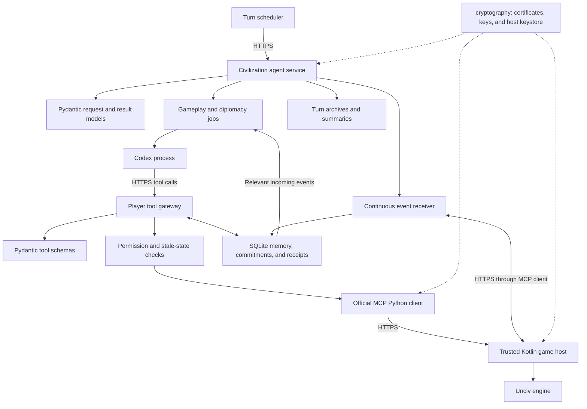
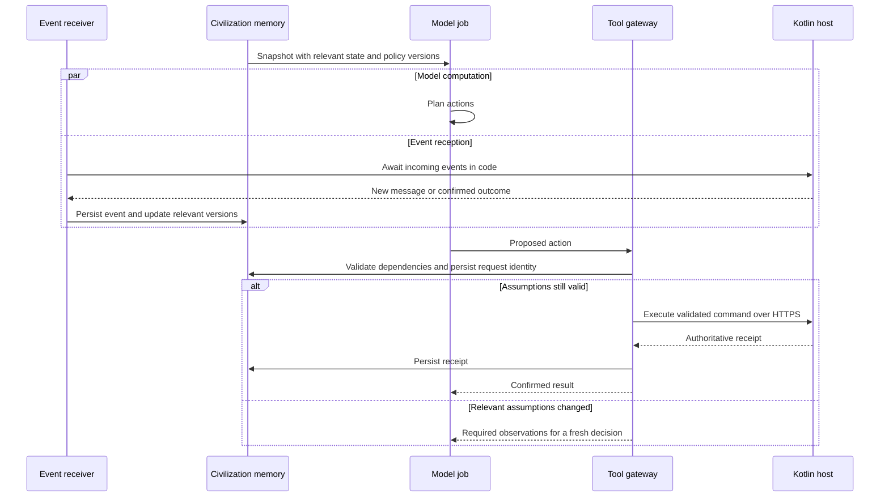

# Python architecture

The Python service coordinates model jobs, player memory and HTTPS calls to the
trusted Kotlin host. Pydantic owns input shapes and tool schemas, the official MCP
Python SDK owns the client protocol, and cryptography provisions TLS identities.

## Boundaries and ownership

[schemas.py](../src/civ_agent/schemas.py) validates activation, chat connection and
interactive-session requests. [result_schema.py](../src/civ_agent/result_schema.py)
allowlists the nested final player view before it can be written into a workspace.
Both reject unknown fields and coercions such as a boolean or numeric string used
as a turn number. API errors expose fixed codes, without the submitted input.

[tool_schemas.py](../src/civ_agent/tool_schemas.py) defines the Python-owned trade,
chat, commitment, history and memory tools. Each model supplies both its advertised
JSON schema and its runtime validation. Optional arguments remain omitted when
forwarded. Engine tool schemas still come from the host, which validates game
commands against the actual state. Identity, authorization, stale assumptions,
memory provenance and durable receipts remain explicit domain checks.

[host_connection.py](../src/civ_agent/host_connection.py) uses the official MCP
client with a pooled, authenticated HTTPS client. One background task owns the SDK
context; requests can run concurrently across the event listener and tool handlers.
Gameplay connections close with their jobs, chat connections with their runtime,
interactive connections with their sessions, and CLI connections with their command.
The client negotiates using `initialize`, the protocol implemented by the Kotlin
host. It rejects redirects, verifies the configured CA and hostname, and sanitizes
SDK wire diagnostics. A failed command is never automatically resubmitted: the
gateway reconciles its durable request ID and receipt with the host.

The gateway's HTTPS server remains in aiohttp. Its request IDs participate in the
durable tool-call cache. Codex's app-server connection also remains separate: it
uses WebSocket over a Unix socket, not MCP. Open-ended upstream Codex event records
retain their existing filtering and history handling.

[tls.py](../src/civ_agent/tls.py) generates RSA keys, the local certificate authority,
server certificates with DNS/IP names, and the JVM host's encrypted PKCS#12 keystore
using cryptography. It verifies validity, signing authority, server purpose, names,
key correspondence and keystore identity. Existing private-file checks, provisioning
locks, atomic writes, stable identities and combined CA trust bundles still apply.
Provisioning requires no OpenSSL executable.

## Concurrency and recovery

Model computation and network waits do not hold the memory writer. `ServiceIO`
serializes short state operations and drains accepted writes during cancellation.
Formal trade negotiation pauses gameplay while communication jobs continue; the
wait happens in code. Checkpoint and rollback behavior is described in
[Chat, memory and recovery](Chat-memory-and-recovery.md).

Library references: [Pydantic strict validation](https://pydantic.dev/docs/validation/latest/concepts/strict_mode/),
[MCP client transports](https://github.com/modelcontextprotocol/python-sdk/blob/main/docs/client/transports.md),
and [cryptography certificate verification](https://cryptography.io/en/stable/x509/verification/).

The Kotlin host's parsing, validation, checkpoint records and communication wakeups
are described in the [Kotlin architecture](Kotlin-architecture.md). `HostConnection`
wraps communication operations in the MCP `request` argument; civilization code
continues to supply the operation fields directly.
