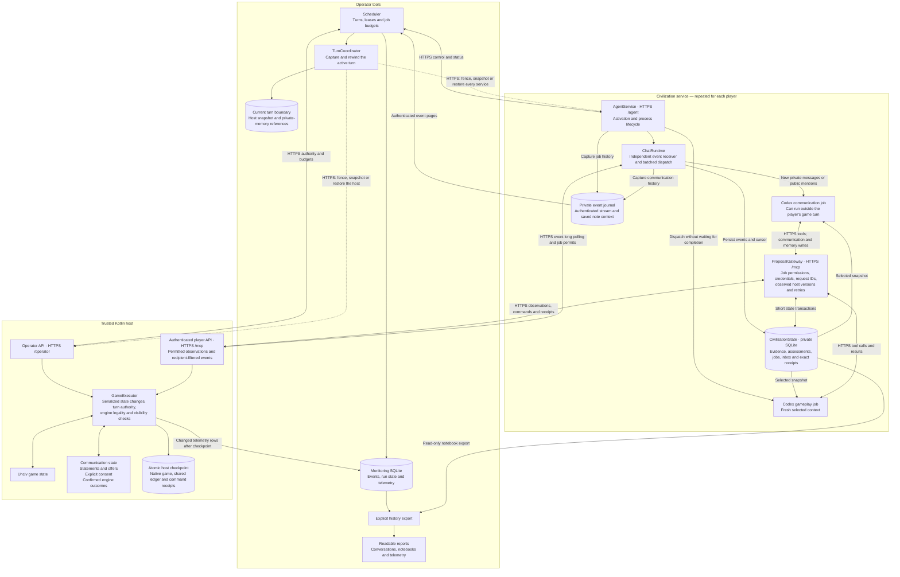

# Gameplay, asynchronous chat and recovery

The civilization-service block is repeated for Rome, Greece and each additional
player. Every service has its own jobs, credentials and private memory. Host and
service network endpoints use HTTPS; local Codex process control uses a Unix
WebSocket.

Only application code waits for events. Gameplay and communication computations
can overlap while memory transactions and action approval remain serialized.
Communication jobs can inspect permitted game information, but cannot issue
gameplay commands or act on native AI trade/friendship offers. Those offers and
their outcomes stay in the gameplay inbox and do not wake communication jobs.
Shared human/agent negotiations still wake their participants asynchronously.
Models select actions and entity IDs; the gateway supplies
transport credentials, request identities and observed versions.

Explicit resume rewinds an interrupted active turn. The dashed recovery paths
capture and restore the game, shared communications and every player's private
state together. Restore creates a new epoch, rotates credentials and retains
usage accounting. Completed turns stay committed; pending strategic reviewers restart
from frozen inputs. The current boundary is published only after every component
is durable. See [turn recovery](Turn-recovery.md).

See the [implementation guide](../guides/Chat-memory-and-recovery.md) for launch commands,
memory layout, verification and remaining coverage/isolation limits.
