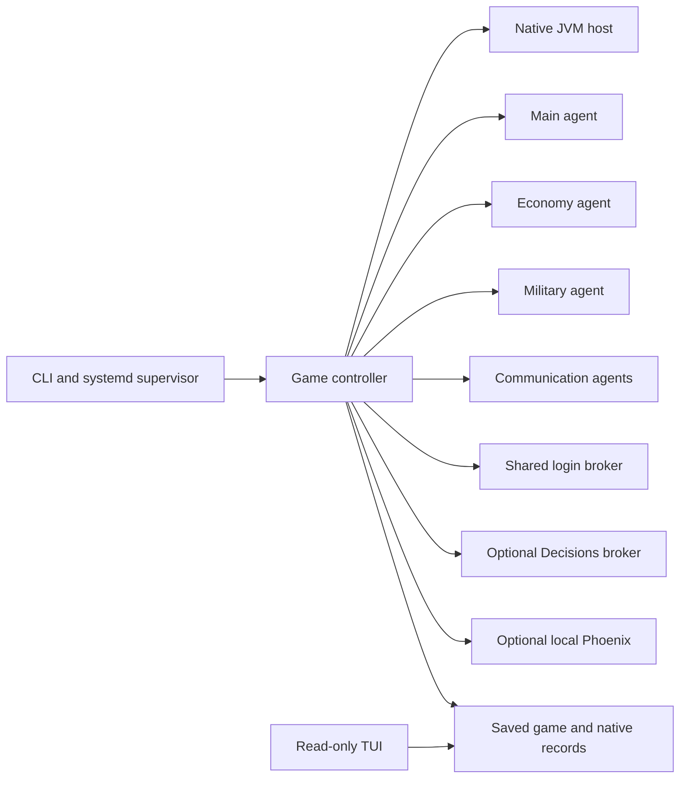

# Container runtime

Each game has one trusted controller container. It runs the native JVM host and
Pydantic AI agents in one async application. Human games use the desktop image,
which adds the native Unciv window and localhost-only browser streaming. There
are no player workers, Temporal services or PostgreSQL volumes.

## Ownership and launch

`commands/game.py` validates configuration, resolves image IDs and starts the
background supervisor. `container_supervisor.py` owns the physical controller
container and its systemd unit. `container_runtime.py` starts the native JVM,
checks readiness and calls `runtime.controller.run_controller`. An unexpectedly
exited JVM fails its controller instead of leaving an orphaned model process.

A version2 container manifest selects `pydantic-local-v1`. It records the logical
game ID, physical deployment ID, exact image IDs and explicit launch intent.
Fresh games have no resume authorization. An explicit `game resume` starts a new
physical launch and grants one recovery attempt. The controller consumes that
launch authorization; an automatic retry cannot repeatedly grant fresh attempts.
The supervisor can reattach to its existing launch without rewriting control
files or starting another controller.

The controller uses fixed Python functions and async tasks for agent hand-off.
Economy and Military may run concurrently, with native action ownership and
mutation checks still enforced by code. Model completion combines the factual
report and role completion fields in one structured output. Native checks decide
whether that completion is accepted and whether Main must reopen.

## Process and network boundaries

Rootless Podman provides the game container's PID, IPC, mount and resource
boundaries. A private control network carries the host and optional browser
endpoint. A separate provider network supplies outbound access. IP forwarding is
disabled; the existing rootless nftables rules block private, host and cross-bridge
egress from the provider interface. The browser port binds only to localhost.
Shared login and Decisions brokers use scoped Unix sockets. The optional Phoenix
interface joins the internal telemetry network.

All player code runs in the trusted controller. Per-player privacy and action
ownership are enforced by authenticated native player connections, scoped domain
stores and the tool catalogue. Agents receive their own instructions, observations,
memory and tools. They do not receive shell or arbitrary filesystem tools.

The controller mounts the complete private match directory writable at `/match`.
It mounts only the credential sources needed by the roster: the login broker
socket, an OpenRouter key file, and the optional Decisions socket. Per-player
broker tokens remain under `agent-services/<civ>/`. Renewable subscription
credentials remain in the separate login broker. Keys and tokens do not appear
in Podman arguments or model inputs.

## Images and observation

`container_images.py` builds runtime and desktop targets from the selected source
and engine checkout. The curated build context excludes credentials, saved games,
local caches and archived documents. Provenance records source/engine revisions,
dirty flags and hashes of packaged source, dependencies and assets. Existing games
retain exact image IDs until an explicit image override is supplied.

The TUI reads runtime-published operator views through a read-only state mount.
History/profile/failure requests use the owner-only Unix socket for frozen
captures; stopped archives are copied to private scratch before SQLite opens.
No observer mount grants write access to a source database. Controller stages and per-role states are shown
separately. A finished Main role cannot mask active specialists or the final
native handoff. Model request counters distinguish gameplay from communication.
Phoenix remains an optional local trace viewer; it is not needed for execution.

## Stop and restart

Stop fences active roles and saves the native position. Both stop and remove retain
the match directory; remove also deletes owned containers, networks and firewall
rules. The systemd owner has bounded retries and never silently adopts a foreign
container. Terminal projections must belong to the current launch and process.

After an application failure, explicit resume reconciles uncertain native requests
and starts fresh agent conversations at the latest native position. Committed
world actions, messages, authored plans, receipts and charged usage remain intact.
The original deadline and total game caps remain in force; per-attempt allowances
refresh. No previous agent graph or model history is replayed. Expected provider
waits follow the bounded model policy and are shown as waiting, not game failures.

For backup, stop the game and retain its full directory, dedicated login directory
and pinned image artifacts. There is no external workflow database. Old Temporal
saves remain read-only archives in this version. The launcher rejects their
execution before starting services and does not convert them.

## Validation

`test_local_container_runtime.py` checks one-controller launch, explicit resume
intent, archive rejection before effects, local status views and separate request
counts. Container ownership, shutdown, image provenance and supervisor reattachment
have independent regression tests. `test_local_routing.py` checks persisted delivery
admission before send, receipt recovery after lost acknowledgements, cancellation
of unsent drafts and instance-local broker calls. These tests use temporary stores
and synthetic host/broker responses; they make no live model requests.
