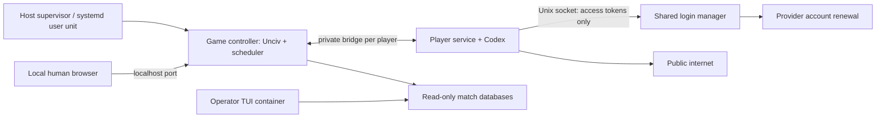

# Game and player containers

The trusted host-side supervisor uses **direct rootless Podman**, with one game
controller and one container per agent. Containers do not receive a Podman socket
or create nested containers. Built-in AI runs within the native engine. A human
seat adds Xvfb, x11vnc and noVNC to the controller's desktop image.

## Responsibility and isolation

`game_config.py` validates separate named player profiles and civilization lists.
Resolution saves independent map/assignment seeds and an explicit player-to-civ
mapping before launching. Random assignment includes every controller type;
balanced batches cycle complete profiles through every civilization. Turn order
is applied afterward: human, agents, built-in AI. Native setup
validation runs the packaged engine before model work. `container_supervisor.py`
owns lifecycle, resource sampling, health checks and the batch queue;
`container_runtime.py` runs services inside images. The existing scheduler still
owns turns, communication waits, reviews and recovery. Controller type does not
change native trade or gameplay mechanics.

Each player has its own network/PID/IPC namespaces, Codex home and filesystem
mounts. Only that player's `agent-services`, `agents` and `codex` subdirectories
are mounted; operator credentials, the CA private key, sibling state and host
home are absent. Leaf certificates and the public CA certificate are copied into
the player's private service directory. The trusted controller can read all match
state for scheduling/recovery. Image contents contain code/assets, never account
credentials or live games.

Each agent/controller pair shares one dedicated bridge. Controller IP forwarding
is disabled. A separate internal bridge carries the human browser. Netavark
network isolation plus nftables rules in Podman's rootless network namespace
block cross-bridge, private-network, host and IPv6 egress from player networks;
DNS and public IPv4 internet remain available. The graphical service binds only
the controller's control interface and is published only on host localhost.
Firewall setup failure aborts startup. Rules are scoped by random persisted game
ID, so cleanup never removes another game's infrastructure.

Containers use read-only root filesystems, dropped capabilities,
no-new-privileges, independent tmpfs directories, and memory/CPU/PID limits.
No host display server, source checkout or general home directory is mounted.
Rootless containers share the Linux kernel; this is not a virtual-machine boundary
or protection from a compromised host operator. Network probes and mount checks
cover the tested paths, not every possible kernel/container exploit.

## Authentication

A dedicated durable Codex login belongs to the operator's existing account.
The login-manager container alone mounts its renewable credential cache. Agent
services authenticate over a mounted Unix socket using individual revocable
client tokens. Only access tokens/account identity are returned. App-server
external-token login and refresh callbacks keep the provider session outside
model-facing content. Account identity changes are rejected during renewal.

One lock serializes refreshes. A hash of the current access token identifies the
bundle across manager restarts, so concurrent failures renew it once. Provisioning
locks serialize simultaneous game starts. Games still share the account's usage
limits; isolation does not create independent provider quotas. A login failure
is surfaced as a service failure. The normal personal Codex configuration is not
imported into player homes.

## Durability and provenance

`resolved.json` freezes both seeds, player profiles, assignments and settings;
`container.json` records image IDs, auth
location and persisted game identity. Images contain host/engine revision and
modified-tree status, Codex version and executable/helper checksums. The image ID
identifies the exact packaged content, including uncommitted source edits.
The selected engine supplies both libraries and assets.

All authoritative game, communication, review, memory, receipt and accounting
state is bind-mounted under the match directory. Container writable layers are
disposable. Review inputs persist before handoff. Resume reuses the existing
[coordinated turn rewind](Turn-recovery.md), recreates containers/networks and
starts fresh player processes. Internal paths are stable `/match/...` paths,
so moving a stopped match on the host does not change stored endpoint paths.
No format migration or legacy production process launcher is retained.

Systemd user units detach supervisors and flush logs into the match directory.
Lingering keeps them alive after logout. An unexpected container exit records its
exit/OOM state and stops only that game. Supervisors do not automatically restart
failed games. Batch queues persist before service startup and retain per-game
outcomes. Container removal leaves durable state intact; images and the dedicated
login must also remain available for resume.

The TUI runs from the saved runtime image with no network. Its match mount is
read-only except for the control directory and SQLite directories (runner, private
notebooks and accounting). SQLite needs those directories to create WAL
coordination files even for `mode=ro` connections. All dashboard queries use
read-only connections. This trusted operator viewer reads existing databases and
does not depend on published game ports. Agents never receive these mounts.

## Verification

`tests/test_run_vanilla_game.py` covers config precedence, invalid settings,
player rotations (including humans and native AI), immutable assignments on resume,
result attribution and directory relocation. `VanillaSetupTest`
checks native map/difficulty/speed/era/victory selection. `test_container_auth.py`
checks parallel authorization, single renewal, broker restart and credential
minimization. `test_container_isolation.py` is an opt-in real-Podman test for
service reachability, sibling/game denial, public internet, mount separation,
read-only roots and dropped capabilities. Live acceptance results are recorded
separately in the coverage ledger.
