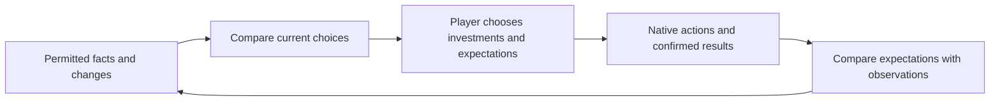

# Decision-process refactor

Status: first implementation and saved-position screening, October 8, 2026.
The baseline, common factual summaries, static comparisons, simplified review,
gameplay-owned choices, receipt feedback and rewind support are implemented.
Long-horizon effectiveness and broader-game acceptance remain evaluation gates;
event-triggered scheduling has not been added. The sections below retain the
design and acceptance plan. The current contracts are in
[structured memory](Structured-memory.md) and [background reviews](Background-turn-memory.md).
The [October 8 report](../archive/reports/Decision-process-refactor-2026-10-08.md)
records tested source versions, results and remaining gates.
This follows the
[October 7 benchmark audit](../archive/reports/Benchmark-agent-play-audit-2026-10-07.md).

## Objective

Improve how players turn available resources, knowledge and military capability
into a stronger position and ultimately a victory. Preserve the player's choice
of strategy, risk tolerance and diplomatic behavior. Make changes to this process
measurable so each disappointing game does not produce another untested prompt
addition.

The proposed loop is:

Use the existing gameplay conversation and read-only strategic adviser. Computing
facts and differences requires no model call. The initial refactor adds no model
roles, post-turn reflection job or additional scheduled review frequency.

## What the code already does, and what is missing

| Existing capability | Refactor needed |
| --- | --- |
| Native city-specific construction, conversion, growth and purchase information | Present the relevant alternatives together with their common assumptions and opportunity costs |
| `review_context.py` compares successive owned positions and lists upcoming events | Relate changes to the player's earlier expectations and preserve relevant outcomes beyond the chronological action-history limit |
| `strategic_review.py` compares plans and gives a preferred plan | Center the report on decisions available now; reduce overlapping short/mid/long-term prose and compulsory per-victory reporting |
| Gameplay-owned `strategy` and `handoff` records; action `intent.expectedOutcome` | Record a few chosen investments and their review points, distinguishing adviser recommendations from player choices |
| Fresh gameplay conversations receive the latest advice | Deliver the current choice and changed evidence together; reconsider when observations invalidate the choice |
| Diplomatic initiative decisions are recorded at END_TURN | Connect diplomatic activity to the player's current objectives and preserve its observed results |
| Saved-position runners, outcome reporting and durable telemetry | Add long-horizon cases, versioned comparisons and clear acceptance criteria |

Two architectural gaps matter. The adviser intentionally excludes prior strategy
and action rationales, so it cannot reliably evaluate whether the player's chosen
plan delivered its expected benefit. Also, the review schema requires an outlook
for every victory even when most have no actionable decision. The latter may
encourage distant finish calculations and reporting; this is a hypothesis to test,
not an established sole cause of the observed behavior.

Use the four current `benchmarks/all-luna` games (`g0001`–`g0004`) as the baseline,
as agreed on October 7. All four inspected games record host revision
`a5358d5`, while current checkout `89a93c0` adds victory-horizon guidance, prepared
action reads, communication changes and war-triggered reviews. Retain agent images
and actual prompt hashes too; the recorded host revision alone does not establish
every agent's instructions. Record these differences when interpreting improvements.
A fresh baseline run on the current checkout is not a prerequisite for implementation.

## 1. Preserve the current games as the baseline

Create a private evaluation manifest from the existing games with source and engine revisions, runtime
image digests, model/provider/effort, prompt and guide hashes, ruleset/speed,
controller assignments, checkpoint hashes and permitted memory at the selected
boundaries. Verify these against retained activation records. Reference fixed
checkpoints and recorded turn ranges so continued play does not silently change
the comparison. Use their existing trajectories and outcomes as baseline evidence;
retain stop reasons and mark unfinished intervals explicitly. Version the new
decision-process schema as well as its prose.

Prepare cases from the retained games:

| Case | Question to evaluate |
| --- | --- |
| Science conversion with weak production | Does the player compare maintaining research output with investments that improve future capacity? |
| Large treasury with planned future purchases | Does reserving or spending gold have a concrete, affordable purpose and timing? |
| Strong army with little operational progress | Does it obtain a useful result, improve its preparation, or reconsider the operation? |
| Greece's productive cultural position | Does the refactor preserve a successful specialization? |

Retain at least one different start as a held-out case. Also keep the existing
settler, worker, growth and combat cases to detect tactical regressions.

Extend the current saved-position and reporting tools. Midgame exports must retain
the same permitted player history across variants or explicitly designate both
as fresh-memory trials. Never reconstruct a player's knowledge from omniscient
operator state. Source games are copied into isolated trials, not resumed or edited.
Keep opponent versions and controller assignments fixed within each comparison.
Later native randomness and model sampling still require repeated trials.

Classify findings as missing information, wrong mechanics, poor investment
comparison, execution failure, failure to reconsider, or service failure. This
determines which component to change. A missing native capability goes into the
coverage ledger rather than being addressed with stronger strategic wording.

## 2. Assemble a common factual decision context

Extend the existing observation/review projections rather than creating a second
game-state model. Supply the same definitions to gameplay and the adviser:

- Current owned output and changes since the relevant earlier observation,
  together with permitted rival comparisons and their observation dates.
- Output from production conversion alongside the underlying city yields, so a
  higher displayed science rate is not confused with improved productive capacity.
- Current construction, time observed on that choice, available alternatives,
  native completion benefits, costs, maintenance, prerequisite blockers and purchase
  prices where available.
- Treasury, committed native payments, happiness/growth constraints, current unit
  roles and relevant observed operational outcomes.
- The player's active expectations, evidence relevant to them and due review points.

Reuse `review_position`, `development_changes`, `upcoming_events`, native
construction estimates and accepted action summaries. Keep detailed catalogues
available through focused reads. Bound startup size by removing duplication and
showing compact summaries with explicit omitted counts, not by hiding legal options
or ranking them with a host-authored strategic score.

Offer narrow comparison support for alternatives the model selects. Start with
city construction versus conversion and purchasing versus waiting. Use native
costs and yield changes, a common horizon and explicit timing assumptions. Report
yield vectors and break-even estimates where meaningful; do not collapse food,
science, culture and security into one invented utility value.

Separate exact current-state calculations from model forecasts. Independent
building estimates cannot simply be added together; growth, citizen assignment,
golden ages, prerequisites and rival responses can change returns. Do not build
a second rules engine or pretend a constant-rate estimate is a simulated future.

For example, a Science-conversion decision should show the research gained by
continuing, the research forgone while an alternative is built, and that alternative's
subsequent native yield changes over the same horizon. A future Lab reserve should
name its plausible unlock and purchase timing. The player may still prefer the
research deadline or reserve; the comparison makes the tradeoff inspectable.

## 3. Replace the report format with a small set of decisions

The adviser should normally compare continuing the present course with one or two
credible alternatives at comparable horizons. These may mix peaceful investment,
expansion, military activity and diplomacy. It can leave the preference open.

For each material choice, retain:

| Field | Purpose |
| --- | --- |
| Objective | A concrete improvement sought, without requiring a permanent victory choice |
| Alternatives and investment | What could be done, resources/time required, and what each option postpones |
| Expected observations | Measurable effects or qualitative evidence expected by a stated time, with uncertainty |
| First actions | Enough detail for gameplay to begin, without preauthorizing stale commands |
| Reconsideration | Evidence, expiry or a review date that could change the decision |
| Information/diplomacy | A specific missing fact or desired player response that could change this choice |

Replace duplicated short-, mid- and long-term sections and per-victory essays with
this structure plus a short overall assessment. Enabled victory rules remain
available. Detailed terminal-project comparisons become relevant when near-term
investments or observed rival progress make them useful. Revisit the broader
victory direction at major changes; this should not lock players into an early
specialization.

Replace exhaustive victory-coverage validation with structural checks on references,
dates and supplied alternatives. Validation should establish that the report can be
used, not certify its strategic quality or require a particular recommendation.

Provide the reviewer with prior selected objectives and expectations as dated
hypotheses, paired with observed outcomes. Exclude the previous recommendation's
persuasive rationale from the default input. Require it to compare current
alternatives afresh, including abandonment. Test for increased plan inertia as
well as better continuity.

## 4. Give player choices one durable home and track their results

Extend the existing gameplay-owned `strategy` record with a small collection of
active decisions, initially at most three. Each has a stable identity, authoring
turn, chosen investment, optional adviser reference, expected observations and
review point. This is a bounded addition to the existing notebook, not another
independent plan store. The `handoff` remains next-turn unfinished work.

Gameplay adopts, changes or rejects recommendations. Adviser preference does not
automatically become player intent. Record choices when they change; do not require
the player to reaffirm them every turn. Extend existing action intent references
where useful, retaining `expectedOutcome` for individual actions. Ordinary moves
need no additional planning form.

Deterministically assemble evidence for each decision from receipts and later
permitted observations. Distinguish:

- Planned action versus accepted command versus observed consequence.
- No evidence of progress versus evidence that a stated expectation was missed.
- Endpoint changes versus changes attributable to that investment.
- Unknown, incomplete and stale evidence versus zero output or failure.

The model interprets whether to continue, adjust or abandon its choice. The service
can say a building completed or a measured rate changed; it must not infer that a
strategy is good, that a removed unit was killed, or that a social promise was broken.
Preserve receipts for corroboration and group relevant outcomes so long wars are
not reduced to whichever actions fit at the end of the 10,000-character history.

At turn startup, present the active choice with material new evidence and any due
review point. The gameplay model can adapt immediately. At the next strategic
review, show expected versus observed results and ask which assumptions changed.
This closes the loop within existing calls.

## 5. Make communication and review scheduling follow decisions

Communication receives the relevant chosen objectives and unresolved diplomatic
questions, with other permitted context available on demand. Record what response
or information an initiative seeks and when it becomes useful to follow up. Read
actual messages and native terms; silence remains a valid decision. Consolidate
the existing initiative outcome mechanism into this structure instead of retaining
two competing notions of plan status.

First retain the existing opening, interval and war review schedule. If evaluations
show that stale decisions persist between reviews, add player-visible requests for
earlier review at the existing safe round boundary: an expectation becomes due,
a required resource disappears, a relevant construction becomes available, or an
operation encounters a material change. Requests should be deduplicated, coalesced
and rate-limited, with scheduling state included in recovery. Ordinary gameplay
need not wait for an adviser to reconsider a choice.

No fixed number of turns at war implies failure. A siege, deterrence mission and
raid have different intended results. Review deadlines come from those objectives,
with sensible scheduling bounds rather than mandatory playstyle rules.

## Ownership, persistence and authority

- Unciv continues to own legal actions and gameplay calculations. The host enforces
  visibility and exposes evidence. Player-model judgments remain advisory to later
  player-model decisions.
- Gameplay remains the sole strategy writer. Communication appends contributions;
  the adviser publishes recommendations. Concurrent contributions respect the
  existing dispatch boundary.
- Decision references and evidence use the existing record/receipt history. Rewind
  restores the matching strategy, expectations, factual baseline and report;
  discarded-future results cannot satisfy an earlier expectation.
- Reuse the current atomic review publication and handoff/finalization protocol.
  Add no post-END_TURN model work and no dependency on a successful strategic
  judgment before a native-legal action.
- Use a new private-store format for the schema change, consistent with current
  fresh-store policy. Introduce it in new trials and new games; preserve old images
  and old state for inspection. Document any evaluation export explicitly instead
  of silently interpreting old data as the new schema.
- Keep hidden operator facts in evaluation reports. Native-legal actions remain
  available regardless of plans, reserve targets, deadlines or social promises.

## Delivery sequence and code ownership

| Step | Main code | Reviewable result and gate |
| --- | --- | --- |
| A. Baseline and diagnosis | `tests/live_strategy_positions.py`, `tests/live_saved_position.py`, `tests/report_strategy_positions.py`, private manifests | Current games preserved as the baseline with fixed checkpoints and recorded intervals; report missing information and infrastructure failures separately |
| B. Factual context and comparisons | `review_context.py`, `construction_estimates.py`, `mechanics_overview.py`, `startup_context.py` | Shared dated facts and focused comparisons; native arithmetic and privacy checks pass; factual-only variant can be measured |
| C. Choices and feedback | `strategic_review.py`, `memory_records.py`, `review_runtime.py`, `review_store.py`, memory schema/snapshots, gateway intents | New report, selected decisions and outcome comparison work through a complete review/play/review cycle and rewind |
| D. Context and communication cleanup | `player_prompts.py`, `startup_context.py`, `strategy_view.py`, relevant chat projections and docs | Superseded report fields and repeated instructions removed; operator can trace recommendation, player choice and actual result |
| E. Evaluate and selectively extend | Existing runners/reporters; `round_review.py` only if evidence warrants | Paired results establish which changes help; event scheduling added only for demonstrated stale-decision failures |

Keep these as small private commits. Engine changes, if a factual capability is
actually missing, must be independently reviewable with engine tests. The first
behavioral experiment should cover one complete investment-and-feedback cycle;
do not postpone measurement until every proposed scheduling feature exists.

The first vertical slice is the Science-conversion case: show a native alternative,
record the player's selected investment and expected effect, let ordinary turns
execute, and deliver the resulting evidence at the next existing review. Once this
works through restart and rewind, apply the same contract to military and diplomatic
decisions. Complete the report-reader and prompt integration needed for that slice
with step C; step D removes remaining duplication and broadens integration.

## Validation and acceptance

**Deterministic checks:** consistent native calculations and estimate assumptions;
no new facts from altered hidden state; missing/stale values remain explicit;
adviser recommendations cannot overwrite player choices; optional records never
block legal actions; idempotent intent/evidence handling; crash/retry/rewind restores
the correct decision version and excludes discarded-future outcomes. Extend existing
tests rather than asserting that prompts contain preferred strategic phrases.

**Live comparisons:** use the current games' recorded trajectories as the baseline
for factual-context changes alone and the full decision loop. Start variants from
retained matching checkpoints, with the same model, effort, engine, permitted
history and opponent versions where the export supports them. Record any mismatch
as a limitation rather than calling the comparison controlled. Screen with a few
five-turn trials, then repeat promising variants across contrasting cases for
20–30 turns. Use at least three repetitions as an initial screen, not statistical
proof; a single historical baseline trajectory does not measure baseline variance.
Replay the original pinned baseline only when additional controls are needed to
resolve an uncertain result. Rotate trial order, retain all attempts and cap
tokens, time and turns explicitly.

Evaluate realized population, productive capacity, research/policy milestones,
useful territorial or military outcomes and costs against the starting position
and matched baseline. Separate conversion and temporary bonuses from underlying
capacity where the native data permits. Record forecast accuracy, decision delay,
context size, calls, tokens and wall time as diagnostic measures. Fewer idle cities,
more spending, fewer wars, more captures or more plan records are not standalone
success criteria. A well-reasoned forecast is also not a substitute for results.

Before each comparison, record the case's intended measures and tolerable regression,
using baseline variation where it is available and marking it unknown otherwise.
Retain a change only when repeated native outcomes
support it, successful specializations remain competitive, and model cost is
proportionate to the gain. If facts alone perform as well, retain the simpler
version. If cases remain ambiguous, report uncertainty rather than adding another
instruction to force the desired action.

Finally run complete games with varied maps and rotated player/civilization/start
assignments. Report native victory results and censored unfinished games separately.
Track host/protocol reliability independently and resolve recurrent blockers before
using those runs to claim improved full-game performance. No small fixture suite
establishes complete player-API coverage or a proven privacy boundary.
