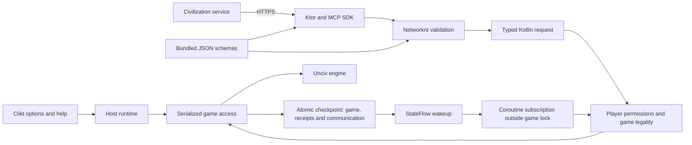
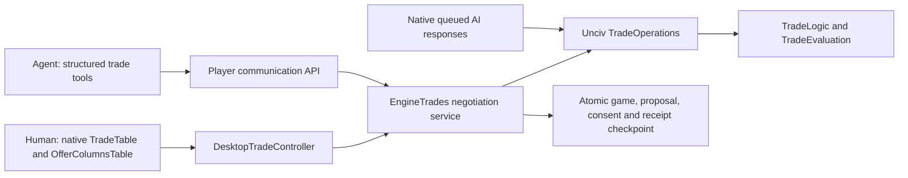

# Kotlin host libraries and request flow

The host uses Clikt for CLI parsing, Networknt for JSON Schema validation,
`kotlinx.serialization` for typed requests and checkpoint records, Ktor and the
MCP Kotlin SDK for HTTPS, and coroutine StateFlow notifications for communication
subscriptions. The selected Unciv checkout supplies the game rules and assets.



## Input contracts

`src/main/resources/uncivai/schemas/` contains the explicit input contracts.
Networknt compiles each bundled schema once, enforces types, limits, allowed
fields and operation-specific required fields, and reports a sanitized
`INVALID_ARGUMENT` on invalid input. Raw validator diagnostics and submitted
values are not returned to players. Only bundled schemas are loaded; request
contents are never interpreted as schemas or reference locations.

`CommunicationRequest` and gameplay request classes provide typed values to the
handlers. Engine legality, visibility, consent/version checks, and request receipt
matching remain explicit. Communication receipts retain the original JSON payload
so a retry still has to match the exact request, including optional fields.
Messages, offers, consent, outcomes, job accounting, and receipt metadata have
typed checkpoint records. Event bodies retain the JSON representation of the
corresponding record for dispatch by event kind.

The MCP SDK's `ToolSchema` supports `properties`, `required`, and `$defs`, but not
root-level operation variants or `additionalProperties`. Communication therefore
uses one `request` argument containing the full operation schema:

```json
{"request": {"op": "read", "epoch": "g1", "cursor": 0, "waitSeconds": 25}}
```

The Python `HostConnection` constructs that transport envelope. Callers within
the Python service and the Kotlin player session use the operation directly.
The actual SDK-serialized schema is tested with Networknt, including its `$ref`
resolution. Ordinary gameplay tools publish their property and required-field
constraints from the same bundled schemas; the host also rejects unknown root
fields, which the SDK cannot currently advertise.

## Shared trade execution



Human–human, human–agent and agent–agent deals use the same operations and
versioned records. Controller type affects presentation, scheduling and the
response deadline, never item availability or execution. Any negotiation involving
a human has no response deadline. The local launcher currently displays one human
seat; the service also accepts two human participants.

- **Engine:** `TradeLogic` supplies native items and quantities. `TradeOperations`
  provides detached drafts, paired treaty edits, optional research funding,
  complete-term validation and enactment. It uses `TradeEvaluation` and native
  effects, including cities, third-party war/peace and relationship modifiers.
  UI maxima, current resource supply, city disposition, treaty symmetry/costs/
  durations and signing affordability are checked here. Native queued acceptance,
  peace operations and AI responses use these same mechanics.
- **Service:** `EngineTrades` owns immutable proposal versions, consent, counters,
  decline/withdrawal, privacy, the gameplay pause, deadlines, durable receipts and
  recovery. It keeps player city references separate from engine city IDs.
- **Adapters:** `DesktopTradeController` supplies the service's lifecycle buttons
  to the native trade table. The structured API supplies the same operations.
  Human review calls `trade_prepare`; agents can call that helper or supply
  fully specified terms directly. Humans confirm the resulting native term list;
  agents receive explicit `give`/`receive` and canonical clauses. Preparing has no gameplay effect and records no consent.

Publishing and accepting never prepare or repair a draft. Acceptance revalidates
the exact stored version immediately before execution. A stale popup or agent
request cannot approve a later counteroffer. Duplicate requests return the stored
receipt; another acceptance of an enacted version cannot repeat its effects.
Turn rewind restores the game, negotiations and receipts together. UI drafts are
kept across ordinary refreshes and discarded when their epoch/version changes.

The built-in AI keeps its native queued lifecycle. Native request comparison
includes amounts **and durations**. Automatic city-state/liberation grants still
use their native engine rules; they are not bilateral player negotiations. Social
promises remain nonbinding advice. See [trade operations and validation](../reference/Asynchronous-trade.md).

## Communication waits

A subscription captures its player's notification version **before** reading the
recipient stream. If the stream has no new events, or a negotiation remains
active, it suspends until that version changes. Comparing the version while
subscribing prevents a commit between the read and subscription from being lost.

Successful commits notify players whose recipient streams changed. Opening or
closing a negotiation wakes all players because the gameplay pause is global;
private terms remain visible only to participants. Operator authority changes,
round restoration, shutdown, and fail-stop also wake subscriptions. Every read
goes through the player-session guard again. No game lock spans a coroutine wait.

The persisted stream and cursor retain delivery history; StateFlow carries only
a wakeup. Cancellation does not consume messages. A quiet timeout performs one
initial read and one final guarded read. The service may renew its HTTPS wait;
no model invocation is needed to keep a subscription open.

Each stateless HTTP request owns its MCP server and session, which are closed at
request completion or cancellation. Authentication still resolves the current
player grant on every request. Transport instances are not cached by credential:
evicting a shared instance could cancel an unrelated in-flight subscription.
Unexpected HTTP failures log exception types and stack frames without messages,
credentials, or request payloads.

## CLI and verification

Run `build/install/unciv-ai/bin/unciv-ai --help` after `./gradlew installDist` for
Clikt-generated help. Existing launcher options remain available. Parsing checks
numeric ranges, choices and paths; startup checks combinations such as a new game
requiring a checkpoint and HTTPS requiring both player and TLS configuration.
Clikt supplies help and error rendering, with a nonzero exit status on errors.

`InputSchemaTest` exercises advertised contracts, malformed nested trade terms,
serialized gameplay defaults and integer bounds. `HostCliTest` verifies parsing
without launching a game. The communication integration probes verify private
visibility, exact consent, restart/retry, cancellation, the read/subscribe race,
negotiation wakeups, and failure before checkpoint replacement. Existing MCP and
CLI integration tests exercise the real HTTPS server.

```sh
./gradlew spotlessApply build installDist
uv run pytest
```
