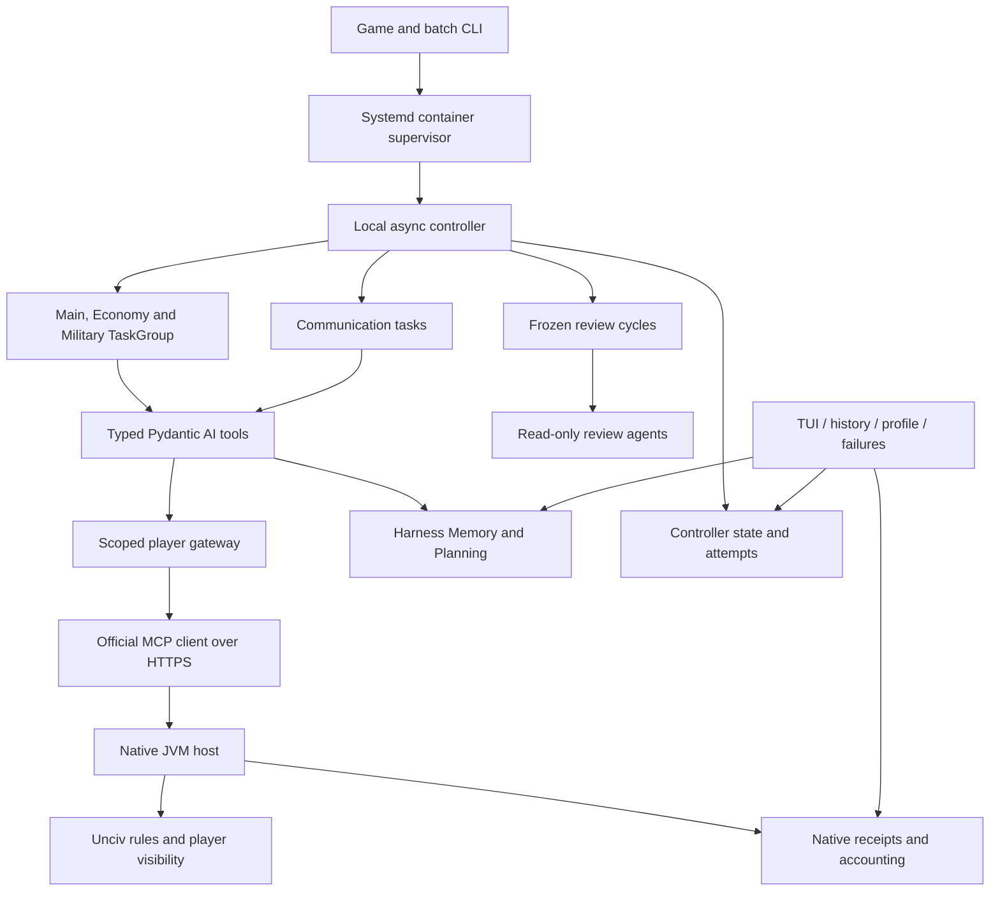

# Python architecture

The Python application runs Pydantic AI agents in one async controller per game.
The controller uses programmatic hand-off: application code starts eligible
roles together, wakes them when work reopens and checks their results. There
is no Temporal service, persisted execution graph or Codex process.

## Turn control and completion

[runtime/controller.py](../../src/civ_agent/runtime/controller.py) owns the game
lease, original deadline, total limits, current attempt and communication barriers.
[runtime/player.py](../../src/civ_agent/runtime/player.py) binds agent roles to
native jobs and their usage. One process keeps prepared player services, provider
clients and connections available across turns.

A turn prepares Main's context to initialize the native role schedules, then
runs Main and eligible Economy and Military work in one `asyncio.TaskGroup`.
Dormant specialists start when native coordination signals work. A completed
role can start another pass while siblings continue; its previous run must
settle first. The controller joins all runs before attempting handoff. A failed
native completion check reopens the roles that need more work. Turn timeouts and
whole-game limits bound repeated work. An inline `economy_wait` joins existing
Economy work through the same lock and ownership checks.

Opening reviews use snapshots captured before the first moves. Later reviews
capture evidence just before their player's confirmed end-turn action and run
while other players play. A review has its own native job and does not depend on
a live Main job. Its advice must be READY or explicitly UNAVAILABLE before that
player's next turn. Publication does not activate a player or open a game barrier.
The controller reserves three native slots for Main, Economy and Military;
ordinary background reviews use the remaining slot. A required review receives
priority before its player's Main job is admitted. A request-level SDK limiter
bounds model calls without holding a slot across an agent's tool waits.

[runtime/agents.py](../../src/civ_agent/runtime/agents.py) uses normal Pydantic AI
agents, typed tools, `ToolOutput` and `HandleDeferredToolCalls`. The terminal
`finish_role` output contains both the short factual report and role completion
fields. Code validates native requirements before accepting it. Definite
rejections become `ModelRetry` feedback in the same agent run. There is no second
`finish_report` model step after role completion.

[role_instructions.py](../../src/civ_agent/orchestration/role_instructions.py)
provides shared missions. A typed [role task](../../src/civ_agent/orchestration/role_tasks.py)
records turn, handoff, pass, reopening reason, pending native choices and legal
deferral information. [native_role_completion.py](../../src/civ_agent/native_role_completion.py)
checks fresh native state. Main may make required choices or explicitly defer
when native rules permit it; Economy may explicitly escalate owned Construction
choices. Completed plans alone do not prove that native choices are resolved.

## Concurrency and authority

Parallel model reasoning does not grant concurrent ownership of the same action.
The trusted coordinator and gateway check player, epoch, role, job, ownership and
fresh observations. Native mutation preparation, execution and application retain
their ordered dispatch boundaries. Shared treasury, city ownership changes and
new native requirements are rechecked before completion and handoff.

The Kotlin host remains authoritative for legality, visibility and native command
receipts. Python can narrow a player's visibility, but cannot invent gameplay
rules or adjudicate social promises as native restrictions. Models receive only
their scoped tools and observations, with no shell or arbitrary filesystem tools.

## Context, authored state and records

Pydantic AI owns agent messages and `RunUsage`. Harness `StepPersistence` records
native histories, snapshots, events and tool effects. It is evidence storage,
not a scheduler or a saved execution graph. Native host receipts remain the source
of truth for committed actions; an interrupted tool record alone cannot authorize
another action.

Harness Memory stores authored notes; Harness Planning stores separate role
plans. The typed CityPlan and Strategy tools validate structured reasoning while
code derives filenames, JSON serialization and version checks. SQLAlchemy Core
stores domain state such as jobs, notifications, delivery admission and ownership.
These responsibilities do not create a second transcript or native receipt ledger.

Context reduction uses the maintained Harness `TieredCompaction` with
`ClearToolResults` and `SlidingWindowCompaction`. It preserves the required recent
exchange and uses canonical memory/plans/native observations for longer-lived
facts. This compaction makes no additional model request. `WarnOnCacheBusts`
reports prompt cache disruption through Python WARNING logging. SDK `Caching`
configures supported caching; a cache warning does not change game authority.

## Connections and supporting packages

The official MCP client and httpx2 handle authenticated HTTPS host connections.
Pydantic AI provider clients handle model protocols and structured output modes.
Provider capability contracts are validated before model work. The shared login
broker retains renewable subscription credentials; Authlib manages OAuth renewal.
Controllers receive scoped access credentials through its authenticated Unix
socket. OpenRouter uses its separately configured read-only key file.

The SDK's `Model` interface is the common provider base. OpenAI Responses,
OpenAI subscription, and OpenRouter use their native SDK models;
[GoogleCloudModel](../../src/civ_agent/orchestration/google_cloud_model.py)
specializes the native `GoogleModel`. Provider-specific wire schemas, tool-result
encoding, and credential error translation belong in that specialization.
Shared retry and context policies consume native model interfaces and error
categories. Both offline preparation and live clients select the same adapter.
Transport transformations copy messages and schemas; canonical validation,
Code Mode values, media, and persisted histories keep their original data.
Google uses standard `AUTO` function calling by default, retaining the full
schemas and local Pydantic validation. Gemini's constrained decoding can reject
valid nested bounds, root object unions, and large action unions. Explicit strict
or forced tool choices remain explicit. JSON-schema references in tool results
are sent as JSON text to avoid Gemini's multimodal `$ref` namespace.
The Google provider owns its production HTTP client so its native long-decode
timeouts apply. A custom short read timeout can repeatedly discard slow responses;
explicit request timeouts still take precedence. Provider clients close both the
Google SDK client and its owned HTTP client.
[Provider transport regressions](../../tests/test_provider_transport_contracts.py)
send the same representative tool results through all four paths, including
streaming, rather than checking only the transformation helpers.

Routing and optional Decisions advice use fixed local async calls. Their broker
owns request deduplication and spending. Outgoing messages persist their exact
payload and task/run admission before send. Native receipts settle delivery,
including a lost acknowledgement. The [failure recovery guide](Failure-recovery.md)
describes restart boundaries.

`cryptography` provisions the local CA, certificates and JVM keystore. Private
files, stable identities and atomic replacement remain application duties.
[Containers](Containers.md) describes launch, credentials and process ownership.

## Restart and observation

An application failure stops for inspection. Explicit resume fences old attempts,
resolves uncertain native requests and starts fresh agent conversations at the
latest native position. Committed actions, messages, authored state, receipts and
spent usage remain. Per-attempt allowances refresh; the original game clock and
total caps remain. Each physical launch can authorize recovery once. Automatic
process replacement cannot invent another operator resume or replay old reasoning.
Old Temporal saves remain readable archives; they are neither executed nor converted.

The TUI reads native accounting and published controller/role phases. Main can be
finished while specialists are running; the display keeps that distinction.
Gameplay and communication model request counts are separate. History, failure and
profile commands read scoped native stores without contacting a provider.
Reviews have their own model counts. Game API counts separately identify agent
tools, background polling and coordinator calls, using code-owned MCP metadata.
Older calls without that metadata remain unclassified. SDK run metadata binds
history readers to the recorded player, role and native job; conversation IDs
are opaque. Context gauges use the Harness context-usage event.

Phoenix remains the local OpenTelemetry UI. Export uses the existing allowlist
of timing, usage and fixed outcome metadata; prompts, observations, tool payloads
and credentials are excluded. Collector failure cannot block gameplay.
See [monitoring](Monitoring.md).
